<div align="center">

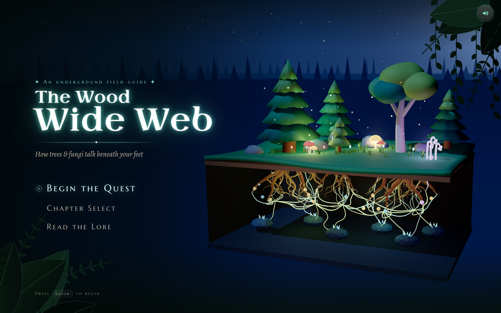

<br>

# 🌲 The Wood Wide Web 🍄

### *How Trees & Fungi Talk Beneath Your Feet*

**An interactive 3D forest quest, real-time mycorrhizal simulation, and procedural Blender-to-WebGL diorama.**

[](https://threejs.org/)
[](./build_wood_wide_web_blender.py)
[](./sfx.js)
[](./index.html)

<p align="center">
  <a href="#-gameplay--simulation-reels">🎬 Video Reels</a> •
  <a href="#-the-five-chapter-quest">📖 Quest Chapters</a> •
  <a href="#-interactive-hud--studio-renders">🖼️ Visual Gallery</a> •
  <a href="#-technical-architecture">⚙️ Architecture</a> •
  <a href="#-quick-start">🚀 Quick Start</a>
</p>

</div>

---

## ✨ Overview

Beneath every quiet forest glade lies a bustling biological internet. Miles of microscopic fungal filaments (**mycelium**) weave copper tree roots together into a shared subterranean network — trading sunlit tree **sugar** for deep rock **minerals**, routing surplus carbon from towering **mother trees** to shaded **saplings**, broadcasting chemical **bug-attack warnings**, and even getting hacked by chlorophyll-free **ghost plants**.

**The Wood Wide Web** turns that real forest ecology into a playable, cozy fantasy field guide:

- **Blender-Parity 3D Diorama**: Built 100% procedurally via Python in Blender (`build_wood_wide_web_blender.py`) and rendered live in Three.js (`engine.js`) with a custom GLSL **AgX Medium High Contrast** view transform calibrated directly against Blender EEVEE studio renders.
- **Playable 5-Chapter Field Guide**: Hands-on missions let you dive into X-Ray soil cutaways, inspect a macro *Hartig net* root handshake, dial canopy sunbeam power, trigger a live caterpillar attack, and track down a parasitic Ghost Pipe.
- **Continuous Celestial & Bioluminescent Clock**: Smooth Catmull-Rom timeline transitions the sky shader, volumetric god rays, sun/moon key lights, drifting spores, twinkling fireflies, and glowing mushrooms from noon through sunset to starry midnight.
- **Procedural Enchanted Soundscape**: Synthesizes every sound effect and 3-layer reactive forest ambience in real time via the **Web Audio API** (`sfx.js`) in D Lydian / D Major Pentatonic — zero external audio files required.
- **Accessible & Zero-Dependency Deployment**: Pure HTML, CSS, and JavaScript with native `<dialog>` and `popover="auto"`, full keyboard/ARIA support, `prefers-reduced-motion` awareness, and an automatic Blender-render fallback if WebGL is unavailable.

---

## 🎬 Gameplay & Simulation Reels

> 💡 *Each preview below plays automatically inline. Click any preview or **Watch HD MP4** link to open the full-resolution `1280×720` H.264 video.*

### 1. Quest Walkthrough — From Night Title to Underground Root Wires

Start at the bioluminescent midnight title screen, press **Begin the Quest** as golden dawn breaks over the conifer ridge in a sweeping quintic crane shot, and dive the camera underground into the X-Ray root & mycelium network.

<div align="center">
  <a href="https://github.com/NourMtir0722/The-Wood-Wide-Web/raw/main/docs/media/quest_walkthrough.mp4">
    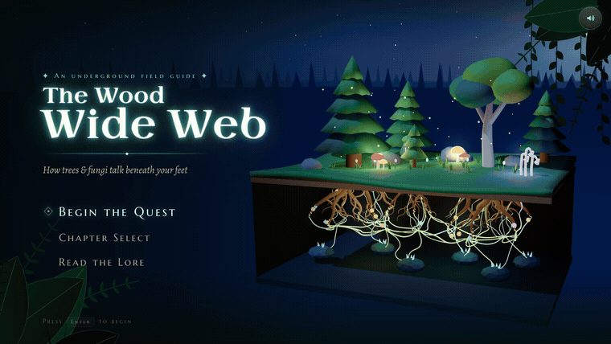
  </a>
  <p>
    <a href="https://github.com/NourMtir0722/The-Wood-Wide-Web/raw/main/docs/media/quest_walkthrough.mp4"><strong>▶️ Watch / Download Full HD Video (<code>quest_walkthrough.mp4</code>)</strong></a>
  </p>
</div>

---

### 2. Continuous Day ↔ Night Celestial & Bioluminescent Cycle

One unified clock (`nightMix: 0 → 1`) drives the custom GLSL sky dome, FBM cloud wisps, setting sun, rising crescent moon, starfield, volumetric sunbeams, golden daytime spores, nocturnal fireflies, and staggered bioluminescent awakening across mushrooms, rune stones, and fungal threads.

<div align="center">
  <a href="https://github.com/NourMtir0722/The-Wood-Wide-Web/raw/main/docs/media/day_night_cycle.mp4">
    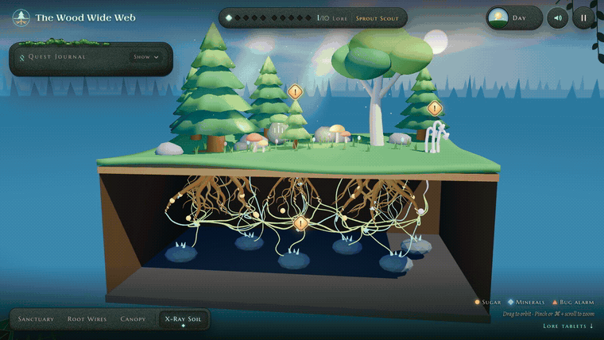
  </a>
  <p>
    <a href="https://github.com/NourMtir0722/The-Wood-Wide-Web/raw/main/docs/media/day_night_cycle.mp4"><strong>▶️ Watch / Download Full HD Video (<code>day_night_cycle.mp4</code>)</strong></a>
  </p>
</div>

---

### 3. Underground Caterpillar Alarm & Ghost Pipe Siphon

In **Chapter IV (*Whispering Wires*)**, launching a caterpillar attack sends a glowing amber distress pulse racing down the Elder Fir's roots and across the shared fungal bridge to the Paper Birch — whose crown blooms emerald as it brews bitter defensive tannins. Then fly over to **Chapter V (*The Ghost Bandit*)** to catch the waxy white *Ghost Pipe* siphoning free tree sugar.

<div align="center">
  <a href="https://github.com/NourMtir0722/The-Wood-Wide-Web/raw/main/docs/media/underground_signals.mp4">
    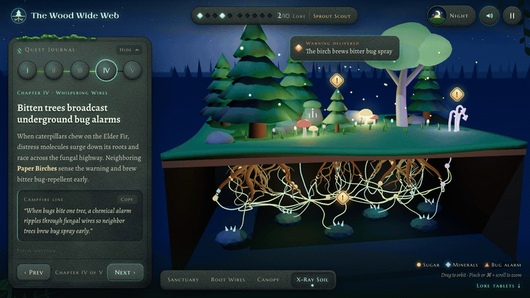
  </a>
  <p>
    <a href="https://github.com/NourMtir0722/The-Wood-Wide-Web/raw/main/docs/media/underground_signals.mp4"><strong>▶️ Watch / Download Full HD Video (<code>underground_signals.mp4</code>)</strong></a>
  </p>
</div>

---

## 📖 The Five-Chapter Quest

Each chapter pairs an illustrated story card, a one-click copyable **Campfire Line** (for explaining the science in one sentence), a choreographed 3D camera flight, and an interactive **Field Mission**:

| Chapter | Title & Ecological Concept | Interactive Field Mission | One-Sentence Campfire Takeaway |
| :---: | :--- | :--- | :--- |
| **I** | **Leaves & Rocks**<br>*Resource Complementarity* | **Dive into Root Wires** — swoop below the moss rim into the X-Ray soil cutaway | *"Trees make food from sunlight, and fungi can squeeze into tiny rock cracks — so they team up."* |
| **II** | **The Underground Pact**<br>*Ectomycorrhizal Hartig Net* | **Open Spirit Lens** — inspect macro day/night studio renders of the root–fungus handshake | *"Fungi act like underground personal shoppers — delivering water and fertilizer to roots and getting paid in sugar."* |
| **III** | **Kinship Network**<br>*Source–Sink Carbon Sharing* | **Sunbeam Power Slider (`10%–100%`)** — modulate canopy sunlight and watch sugar/mineral particle throughput respond live | *"Tall sunlit trees share extra sugar through the fungal web to keep shaded baby trees alive."* |
| **IV** | **Whispering Wires**<br>*Inter-Plant Defense Signaling* | **Launch Caterpillar Attack** — dispatch an underground chemical alarm from the Elder Fir to arm the Paper Birch | *"When bugs bite one tree, a chemical alarm ripples through fungal wires so neighbor trees brew bug spray early."* |
| **V** | **The Ghost Bandit**<br>*Mycoheterotrophy* | **Track the Ghost Pipe** — fly to *Monotropa uniflora* siphoning carbon without chlorophyll | *"Even forests have hackers — waxy white ghost plants plug into the fungal web to siphon free tree sugar."* |

### 🌿 Cast of Organisms (Interactive 3D Codex)

Clicking any of the **5 floating 3D pins** projected onto the diorama opens a parchment **Codex Popover** and lights one of the **10 Lore Runes** (*Sprout Scout* → *Root Ranger* → *Mycelium Seer* → *Forest Whisperer*):

| Organism | Archetype | ↑ Gives into the Web | ↓ Gets from the Web |
| :--- | :--- | :--- | :--- |
| **Elder Fir** | *Mother Hub Tree* | Up to 30% of its sunlit carbon sugar | Deep rock water, phosphorus & nitrogen |
| **Shaded Sapling** | *Baby Tree* | A future sunlit partner once it reaches the canopy | Life-saving sugar & minerals via fungal bridges |
| **Paper Birch** | *Neighbor Species* | Summer leaf-sugar surpluses into the shared grid | Early caterpillar-attack warnings & deep nutrients |
| **Mycelium Web** | *The Network Itself* | Minerals dissolved from microscopic rock crevices | Sweet tree sugar (fungi have no chlorophyll) |
| **Ghost Pipe** | *The Bandit* | **Nothing at all** — zero photosynthesis | Free tree sugar siphoned straight from living hyphae |

---

## 🖼️ Interactive HUD & Studio Renders

### Live WebGL Interface & Lore Progression

| Sunlit Sanctuary & Quest Journal | 3D Codex Popover & Rune Progression |
| :---: | :---: |
| 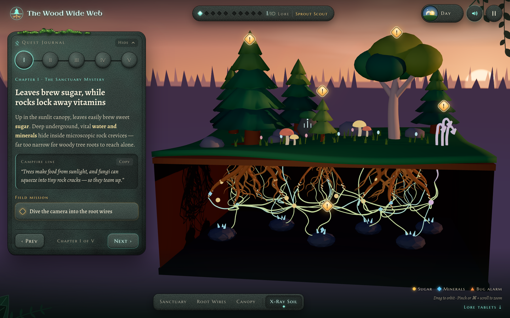 | 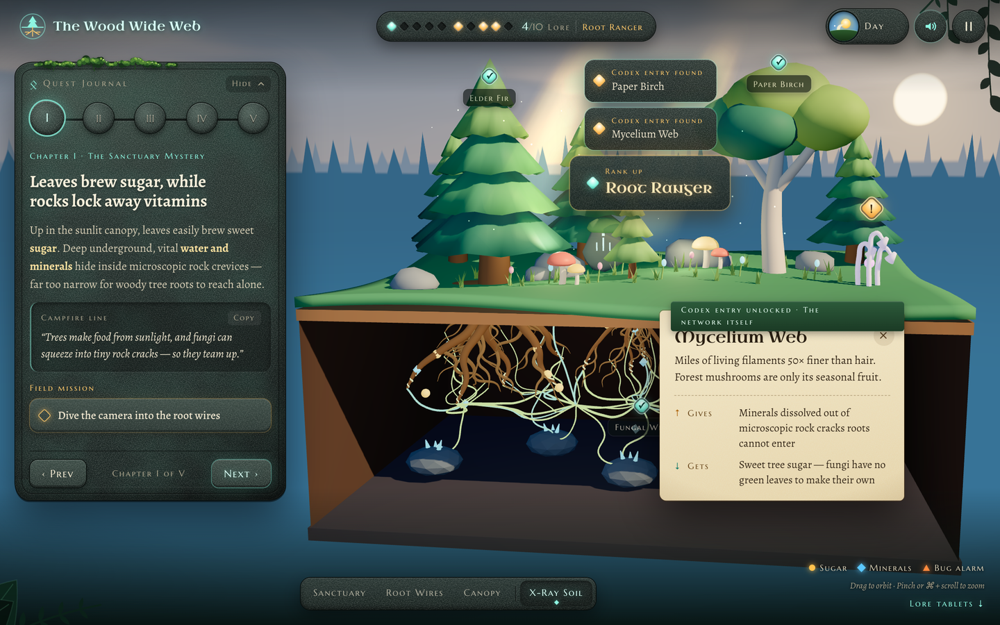 |
| *Carved mossy-stone Quest Journal, Celestial Dial, 10-socket Lore Meter, and off-axis camera framing.* | *Screen-projected 3D anchors track organisms during orbit and reveal symbiotic trade balances.* |

| Spirit Lens — Macro Hartig Net Dialog | Lore Tablets & Campfire Riddles |
| :---: | :---: |
| 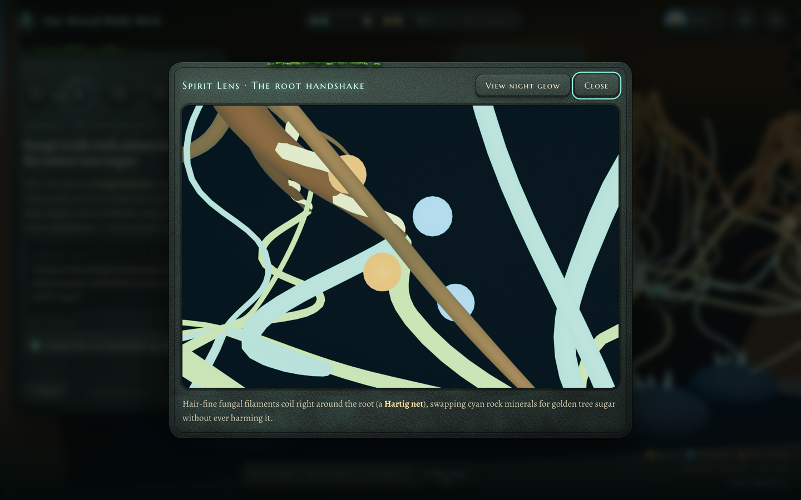 | 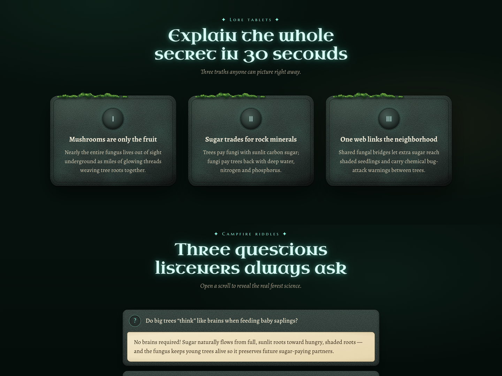 |
| *Switchable Day / Night macro inspection of fungal hyphae coiling around copper root tips.* | *30-second summary tablets and expandable Q&A scrolls below the 3D viewport.* |

---

### Procedural Blender EEVEE Studio Renders (`1360×880` AgX)

All 3D geometry, materials, crystal pockets, branching roots, and light rigs are generated deterministically by [`build_wood_wide_web_blender.py`](./build_wood_wide_web_blender.py) and calibrated so the real-time Three.js canvas matches Blender's EEVEE output:

| Sanctuary Overview — Sunlit Noon | Sanctuary Overview — Bioluminescent Midnight |
| :---: | :---: |
| 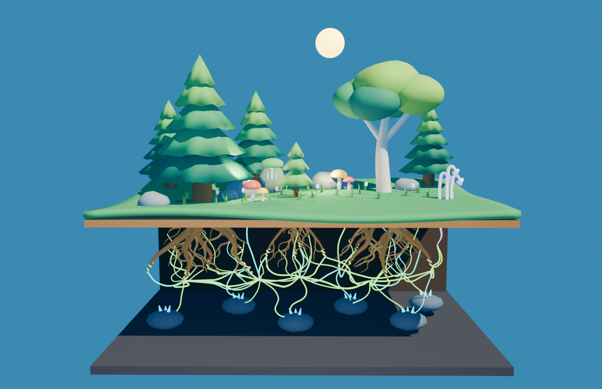 | 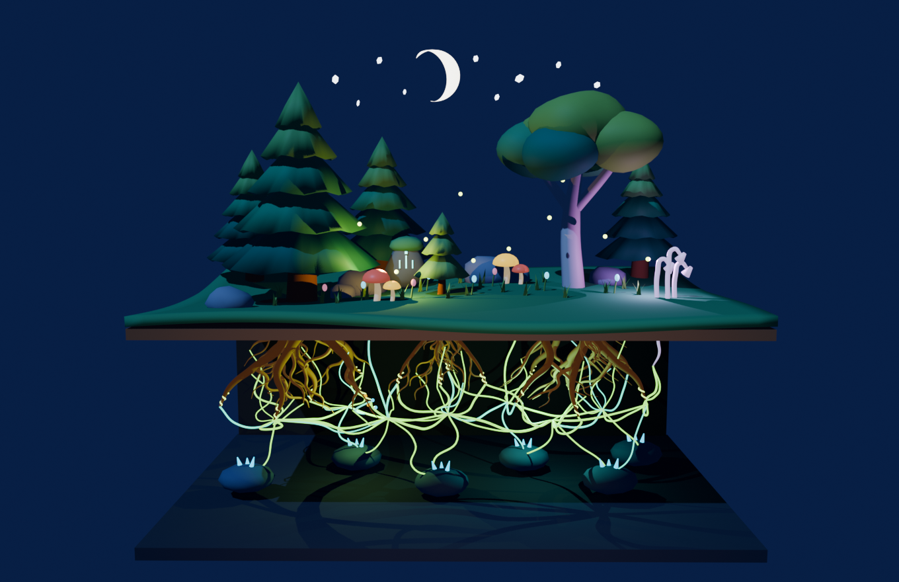 |

| Root Handshake Macro — Daylight | Root Handshake Macro — Night Glow |
| :---: | :---: |
| 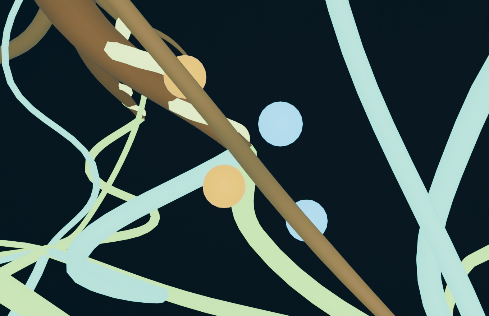 | 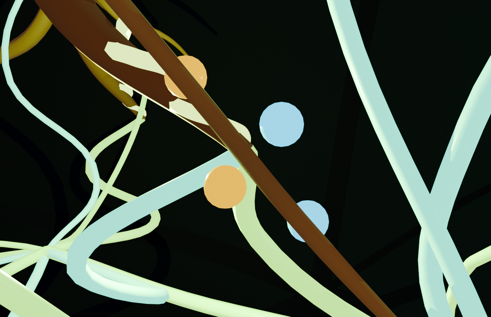 |

---

## ⚙️ Technical Architecture

<div align="center">
  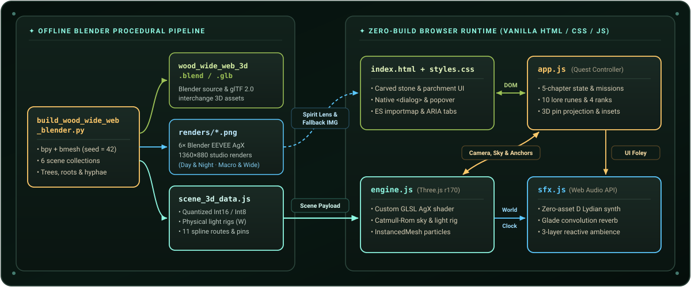
</div>

### Key Engineering Highlights

1. **Quantized Binary-Packed Scene Payload (`build_wood_wide_web_blender.py` → `scene_3d_data.js`)**
   - Merges procedural meshes by material batch, quantizes vertex coordinates into `Int16` and normals into `Int8`, Base64-encodes buffers, and exports exact physical lamp energies (`SUN` in `W/m²`, `AREA` and `POINT` in `W`), 11 subterranean particle polylines (`ROUTES_3D`), and 5 3D HUD anchor coordinates (`ANCHORS_3D`).
   - Loads directly via a `<script defer>` tag — avoiding `fetch()` CORS issues while keeping geometry fast to decode into `THREE.BufferGeometry`.

2. **Blender-Calibrated AgX Tone Mapping & Catmull-Rom Sky (`engine.js`)**
   - Injects a custom GLSL `CustomToneMapping` shader implementing the **Rec.2020 AgX inset matrix**, log-space contrast pivot (`exposure: 0.6`, `contrast: 1.25`, `pivot: 0.475`, `saturation: 1.05`), 6th-order sigmoid curve, and sRGB outset to match Blender 5.x's *AgX — Medium High Contrast* look.
   - Uses Catmull-Rom spline interpolation across `nightMix` keyframes to drive sky radiance, horizon FBM clouds, celestial discs, shadow-casting sun/moon swap, volumetric beam cones, additive GLSL fireflies/spores, and GPU-instanced (`THREE.InstancedMesh`) sugar, mineral, siphon, and bug-alarm particles.
   - Dynamically shifts the camera's projection center (`camera.setViewOffset`) so the 3D diorama stays centered in the open viewport space beside the collapsible Quest Journal on desktop and above the bottom sheet on mobile.

3. **Zero-Asset Procedural Web Audio Synthesizer (`sfx.js`)**
   - Generates a seamless 3-second **Paul Kellet pink-noise** foley buffer and a custom 1.55-second stereo **forest-glade impulse response** (`ConvolverNode`) at startup.
   - Runs a 3-layer continuous world soundscape (bandpass LFO canopy breeze, `D2 + A2 + D3` subterranean mycelium resonance, and stochastic daytime songbirds / nocturnal crickets & spore chimes) modulated every frame by camera depth, X-Ray mode, sunlight percentage, and time of day.
   - Synthesizes tactile RPG foley in **D Lydian / D Major Pentatonic**: mossy stone clicks, hollow wooden marimba/kalimba plucks, parchment rustles, crystal rune bells, and stereo-panned caterpillar crunches.

---

## 🎮 Controls & Accessibility

| Input / Control | Action |
| :--- | :--- |
| **Drag** (Mouse / 1-Finger Touch) | Orbit camera smoothly around the forest sanctuary |
| **Pinch** or **`⌘` / `Ctrl` + Scroll** | Zoom camera in and out (leaves normal page scrolling intact!) |
| **`Enter`** *(on Title Screen)* | Begin the quest immediately |
| **`↑` / `↓`** & **`Escape`** *(Title Menu)* | Navigate title / chapter menus with keyboard |
| **`←` / `→` / `Home` / `End`** *(Chapter Tabs)* | Cycle through Chapters `I`–`V` and trigger camera flights |
| **Celestial Dial (`Day` / `Night`)** | Animate full sunset / sunrise cycle across sky, lights & audio |
| **`Sanctuary` · `Root Wires` · `Canopy`** | Fly camera along quintic crane arcs to preset vantage points |
| **`X-Ray Soil`** | Fade cutaway earth wall (`0.55 ↔ 0.06` opacity) to reveal roots & crystals |
| **Sound / Pause Buttons** | Mute Web Audio synth (persisted in `localStorage`) or pause motion |

- **Reduced Motion & Offline Resilience**: Honors `prefers-reduced-motion: reduce` (snapping camera transitions and muting attract-mode orbit), pauses WebGL rendering & ducks audio via `IntersectionObserver` when scrolled to the Lore section, and falls back gracefully to `renders/overview_day_3d.png` if WebGL or CDN imports are unavailable.

---

## 🚀 Quick Start

### Run Locally (Zero Install)

Because `index.html` loads `three` via a standard ES `<script type="importmap">`, serve the folder over any local HTTP server:

```bash
# Clone the repository
git clone https://github.com/NourMtir0722/The-Wood-Wide-Web.git
cd The-Wood-Wide-Web

# Start a local static server (Python 3)
python3 -m http.server 8000
```

Then open **[http://localhost:8000](http://localhost:8000)** in any modern browser.

*(Alternatively, with Node.js: `npx serve .`)*

### Deploy to GitHub Pages

This repository requires **no build step** and runs out-of-the-box on GitHub Pages:
1. Open **Settings → Pages** in this GitHub repository.
2. Under **Build and deployment**, select **Deploy from a branch** → Branch: `main` / `/ (root)` → **Save**.

### Rebuild the 3D Scene & Studio Renders (Optional)

If you have **Blender 4.2+ / 5.x** installed and want to tweak the procedural trees, root topology, crystal pockets, or lighting in [`build_wood_wide_web_blender.py`](./build_wood_wide_web_blender.py):

```bash
# macOS default Blender path (or `blender` if on your PATH)
/Applications/Blender.app/Contents/MacOS/Blender --background --python build_wood_wide_web_blender.py
```

This regenerates:
- `wood_wide_web_3d.blend` & `wood_wide_web_3d.glb`
- All 6 studio renders in `renders/*.png`
- The quantized web geometry & lighting bundle in `scene_3d_data.js`

---

## 📂 Project Structure

```text
The-Wood-Wide-Web/
├── index.html                      # Semantic markup, SVG emblems, Quest Journal, Codex popover & Spirit Lens dialog
├── styles.css                      # Carved mossy stone, glowing rune & parchment UI theme + responsive mobile sheet
├── app.js                          # Quest state machine, camera choreography, lore ranks, pins & accessibility
├── engine.js                       # Three.js WebGL renderer, custom GLSL AgX shader, sky timeline & instanced particles
├── sfx.js                          # Zero-asset Web Audio API procedural soundscape & RPG foley synthesizer
├── scene_3d_data.js                # Quantized 3D geometry batches, light rigs, spline routes & anchors exported from Blender
├── build_wood_wide_web_blender.py  # Deterministic procedural Blender Python builder & exporter
├── wood_wide_web_3d.blend          # Generated Blender source scene (6 organized collections)
├── wood_wide_web_3d.glb            # Standard glTF 2.0 binary 3D model export
├── renders/                        # 1360×880 Blender EEVEE AgX studio renders (Day & Night, Overview & Root Macro)
└── docs/media/                     # Live WebGL gameplay videos (.mp4), inline previews (.gif) & UI screenshots (.png)
```

---

<div align="center">
  <p><em>Crafted with curiosity for the hidden fungal networks beneath every forest floor.</em> 🌱✨</p>
</div>
